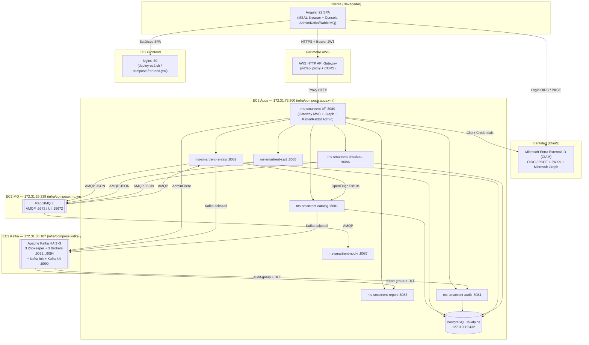
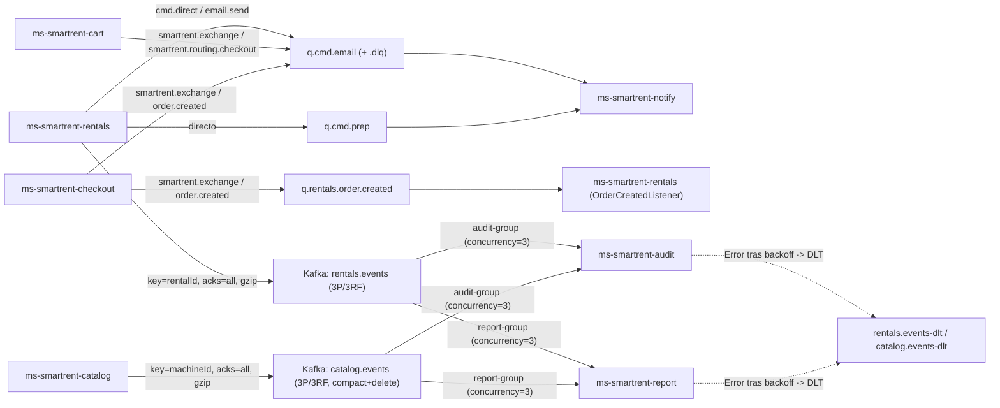

<h1 align="center">
  🚜 SmartRent — Plataforma Cloud-Native de Arriendo de Maquinaria
</h1>

<p align="center">
  <strong>Ecosistema distribuido de microservicios Spring Boot, SPA Angular 22, Zero-Trust Entra External ID, RabbitMQ y Clúster Apache Kafka HA 3×3</strong>
</p>

<p align="center">
  
  
  
  
  
  
  
</p>

---

Repositorio principal de **SmartRent**, una plataforma empresarial *Cloud-Native* para la gestión integral de arriendo de maquinaria industrial, desarrollada para la asignatura **Desarrollo en Cloud Native (DUOC UC)**.

La solución implementa una arquitectura de **8 microservicios desacoplados**, una **SPA Angular 22**, autenticación y autorización **Zero-Trust con Microsoft Entra External ID (CIAM)**, mensajería híbrida (**RabbitMQ** para comandos/órdenes + **Apache Kafka HA 3×3** para eventos de dominio, auditoría y reportería) y despliegue automatizado multi-EC2 con **Docker Compose** y **AWS HTTP API Gateway**.

---

## 🌐 Accesos y URLs de Despliegue (AWS)

Todas las instancias cuentan con **IP Elástica fija** e **IP Privada VPC fija**, permitiendo autoarranque automático en AWS Academy Learner Lab:

| Servicio / Consola | URL de Acceso | Instancia EC2 / Detalle |
| :--- | :--- | :--- |
| **🌐 Frontend (SPA Angular 22)** | https://tv9aux1za4.execute-api.us-east-1.amazonaws.com | AWS HTTP API Gateway (`$default`) → `EC2-Frontend` (`34.225.219.131:80`) |
| **⚙️ Backend API (BFF Gateway)** | https://hnws3rgb6i.execute-api.us-east-1.amazonaws.com/v2/api | AWS HTTP API Gateway (`hnws3rgb6i`) → `EC2-Apps` (`172.31.76.200:8080`) |
| **🔎 Catálogo Público (Health/Prueba)** | https://hnws3rgb6i.execute-api.us-east-1.amazonaws.com/v2/api/catalog/services | `GET` público hacia `ms-smartrent-catalog` + PostgreSQL 15 |
| **⚡ Apache Kafka UI (HA 3×3)** | http://3.231.182.87:8090 | `EC2-Kafka` (`3.231.182.87` / VPC `172.31.30.107:9092..9094`) — acceso directo |
| **🐇 RabbitMQ Management UI** | http://100.50.92.218:15672 | `EC2-MQ` (`100.50.92.218` / VPC `172.31.29.239:5672`) — usuario `guest` / `guest` |

> **Nota:** Las URLs de Kafka UI y RabbitMQ Management utilizan `http://` (puertos `8090` y `15672`), mientras que Frontend y Backend operan bajo `https://` a través de AWS HTTP API Gateway.

---

## 🧭 Arquitectura General



---

## 📦 Módulos del Ecosistema

| Módulo | Tecnología | Puerto | Responsabilidad Principal | Documentación |
| :--- | :--- | :---: | :--- | :--- |
| **`frontend-smartrent`** | Angular `22.2.4`, TypeScript `6.0`, MSAL, Chart.js, Vitest | `4200` / `80` | SPA cliente, catálogo, carrito, checkout, arriendos, auditoría, reportes y consola Admin (Usuarios, Inventario, Bodega, KPIs, RabbitMQ, Kafka). | [README](./frontend-smartrent/README.md) |
| **`ms-smartrent-bff`** | Spring Boot `3.3.2`, Gateway MVC, Kafka AdminClient, Graph API | `8080` | Punto de entrada unificado (`/api`, `/v1/api`, `/v2/api`), enrutamiento, RBAC perimetral, directorio Azure Graph y administración RabbitMQ/Kafka. | [README](./ms-smartrent-bff/README.md) |
| **`ms-smartrent-catalog`** | Spring Boot `3.3.2`, JPA/PostgreSQL, Kafka Producer | `8081` | Gestión de maquinarias y categorías, control de disponibilidad y publicación de eventos a `catalog.events`. | [README](./ms-smartrent-catalog/README.md) |
| **`ms-smartrent-rentals`** | Spring Boot `3.3.2`, JPA, OpenFeign, RabbitMQ, Kafka Producer | `8082` | Ciclo de vida y máquina de estados de arriendos, prevención IDOR, sincronización con catálogo y emisión de eventos AMQP/Kafka. | [README](./ms-smartrent-rentals/README.md) |
| **`ms-smartrent-report`** | Spring Boot `3.3.2`, Kafka Consumer | `8083` | Agregación en tiempo real de KPIs diarios, top maquinarias, arriendos por estado y actividad de catálogo desde Kafka. | [README](./ms-smartrent-report/README.md) |
| **`ms-smartrent-audit`** | Spring Boot `3.3.2`, JPA/PostgreSQL, Kafka Consumer | `8084` | Trazabilidad inmutable (`AUDIT_TIMELINE`) de eventos de arriendos, catálogo y Dead Letter Topics (`*-dlt`). | [README](./ms-smartrent-audit/README.md) |
| **`ms-smartrent-cart`** | Spring Boot `3.3.2`, JPA/PostgreSQL, RabbitMQ Producer | `8085` | Persistencia y sincronización del carrito de compras (`express` / `quote`) por usuario autenticado. | [README](./ms-smartrent-cart/README.md) |
| **`ms-smartrent-checkout`** | Spring Boot `3.3.2`, JPA/PostgreSQL, RabbitMQ Producer | `8086` | Procesamiento transaccional de órdenes (`Order` / `OrderItem`) y publicación del evento `order.created`. | [README](./ms-smartrent-checkout/README.md) |
| **`ms-smartrent-notify`** | Spring Boot `3.3.2`, RabbitMQ Consumer | `8087` | Worker asíncrono de notificaciones por correo (`q.cmd.email` + `q.cmd.email.dlq`) y tickets de picking (`q.cmd.prep`). | [README](./ms-smartrent-notify/README.md) |
| **`infra`** | Docker Compose, Confluent Kafka 7.4, RabbitMQ 3, PostgreSQL 15 | — | Orquestación multi-EC2, clúster Kafka HA 3×3 y scripts CLI replicables (`init-topics.sh`, `manage-kafka.sh`). | [README](./infra/README.md) |

---

## 🛡️ Seguridad Zero-Trust y Matriz RBAC

Toda la plataforma valida tokens JWT emitidos por **Microsoft Entra External ID (CIAM)** de forma independiente en el BFF y en cada microservicio HTTP (**defensa en profundidad / Zero-Trust**):

- **Validación criptográfica**: firma mediante `jwk-set-uri`, verificación estricta de `iss` y coincidencia exacta de `aud` (`749dc676-d557-460a-b138-dac9a6744b6e` o `api://749dc676-d557-460a-b138-dac9a6744b6e`).
- **Normalización de roles**: el `JwtAuthenticationConverter` mapea claims `roles` a autoridades Spring (`ROLE_ADMIN`, `ROLE_JEFEBODEGA`, `ROLE_AUDITOR`, `ROLE_ARRENDATARIO`) junto con `@EnableMethodSecurity(prePostEnabled = true)`.
- **Prevención IDOR**: `ms-smartrent-rentals` contrasta el `userId` solicitado contra `oid`, `sub`, `email` y `preferred_username` del JWT; `ms-smartrent-cart` y `ms-smartrent-checkout` derivan el titular directamente del `@AuthenticationPrincipal Jwt`.

| Recurso / Dominio | Visitante | `Arrendatario` | `JefeBodega` | `Auditor` | `Administrador` |
| :--- | :---: | :---: | :---: | :---: | :---: |
| `GET /api/catalog/services` (disponibles) | ✅ | ✅ | ❌ *(usa `/all`)* | ❌ | ❌ *(usa `/all`)* |
| `GET /api/catalog/services/all` y mutaciones | ❌ | ❌ | ✅ | ❌ | ✅ |
| `/api/cart/**` y `/api/checkout/**` | ❌ | ✅ *(propio)* | ❌ | ❌ | ✅ |
| `GET/POST /api/rentals/**` | ❌ | ✅ *(solo propios)* | ✅ *(todos)* | ❌ | ✅ *(todos)* |
| `PUT /api/rentals/{id}/status` | ❌ | ❌ | ✅ | ❌ | ✅ |
| `GET /api/audit/**` | ❌ | ❌ | ❌ | ✅ | ✅ |
| `GET /api/reports/**` | ❌ | ❌ | ✅ *(MS)* | ✅ *(MS)* | ✅ *(BFF + MS)* |
| `/api/users/**`, `/api/queues/**`, `/api/exchanges/**`, `/api/bindings/**`, `/api/kafka/**` | ❌ | ❌ | ❌ | ❌ | ✅ |

---

## 📨 Arquitectura Orientada a Eventos (RabbitMQ + Kafka HA 3×3)



### Tópicos Oficiales de Apache Kafka
| Tópico | Particiones | Réplicas | `min.insync.replicas` | `cleanup.policy` | Retención | Productor | Consumidores |
| :--- | :---: | :---: | :---: | :---: | :---: | :--- | :--- |
| `rentals.events` | 3 | 3 | 2 | `delete` | 7 días / 1 GB | `ms-smartrent-rentals` | `audit-group`, `report-group` |
| `catalog.events` | 3 | 3 | 2 | `compact,delete` | 14 días | `ms-smartrent-catalog` | `audit-group`, `report-group` |
| `rentals.events-dlt` | 3 | 3 | 2 | `delete` | 30 días | `DefaultErrorHandler` | `audit-group-dlt`, `report-group-dlt` |
| `catalog.events-dlt` | 3 | 3 | 2 | `delete` | 30 días | `DefaultErrorHandler` | `audit-group-dlt`, `report-group-dlt` |

---

## 🚀 Inicio Rápido

### Prerrequisitos
- **Backend**: JDK 17+ (Maven Wrapper `./mvnw` incluido en cada microservicio).
- **Frontend**: Node.js 22 LTS y NPM 11+.
- **Contenedores**: Docker Engine y Docker Compose v2+.

### 1. Levantar la infraestructura y microservicios con Docker Compose
```bash
# 1. Mensajería RabbitMQ
docker compose -f infra/compose.mq.yml up -d

# 2. Clúster Kafka HA 3×3 (3 Zookeeper + 3 Brokers + kafka-init + Kafka UI :8090)
docker compose -f infra/compose.kafka.yml up -d

# 3. 8 Microservicios + BFF (:8080) + PostgreSQL 15
docker compose -f infra/compose.apps.yml up -d --build

# 4. (Opcional) Poblar base de datos inicial con categorías y 13 maquinarias
docker exec -i smartrent-postgres psql -U smartrent -d smartrent_audit < aws_seed_data.sql

# 5. Frontend Angular en Nginx (:80)
docker compose -f infra/compose.frontend.yml up -d --build
```

### 2. Desarrollo local rápido (Frontend)
```bash
cd frontend-smartrent
npm ci
npm start   # http://localhost:4200
```

---

## 🧪 Pruebas Unitarias y Cobertura

Todos los microservicios estandarizan **JUnit 5 + Mockito + JaCoCo `0.8.14`**, y el frontend utiliza **Vitest `4.x` + `@vitest/coverage-v8`**:

```bash
# Ejecutar pruebas y generar reporte JaCoCo en un microservicio (repetir por servicio)
cd ms-smartrent-bff
./mvnw test -B
# Reporte HTML en: target/site/jacoco/index.html

# Ejecutar pruebas y cobertura del Frontend Angular
cd frontend-smartrent
npx ng test --watch=false --coverage
```

---

## 📚 Documentación Adicional y Operación

- **[Guía de Comandos AWS EC2, Docker, PostgreSQL y Kafka CLI](./COMANDOS_AWS.md)**: diagnóstico RAM/disco, despliegue en Learner Lab, tabla de IPs privadas VPC y monitoreo del clúster Kafka.
- **[Guía de Infraestructura y Scripts Kafka](./infra/README.md)**: detalle de los 4 archivos `compose.*.yml` y utilidades `init-topics.sh` / `manage-kafka.sh`.
- **[Guía de Contribución y GitHub Flow](./CONTRIBUTING.md)**: reglas de ramas, commits y Pull Requests hacia `main`.
- **[Seed Data SQL](./aws_seed_data.sql)**: script inicial de categorías y maquinarias para PostgreSQL.

<p align="center">
  <br>
  <i>SmartRent — Arquitectura Cloud-Native • DUOC UC</i>
</p>
