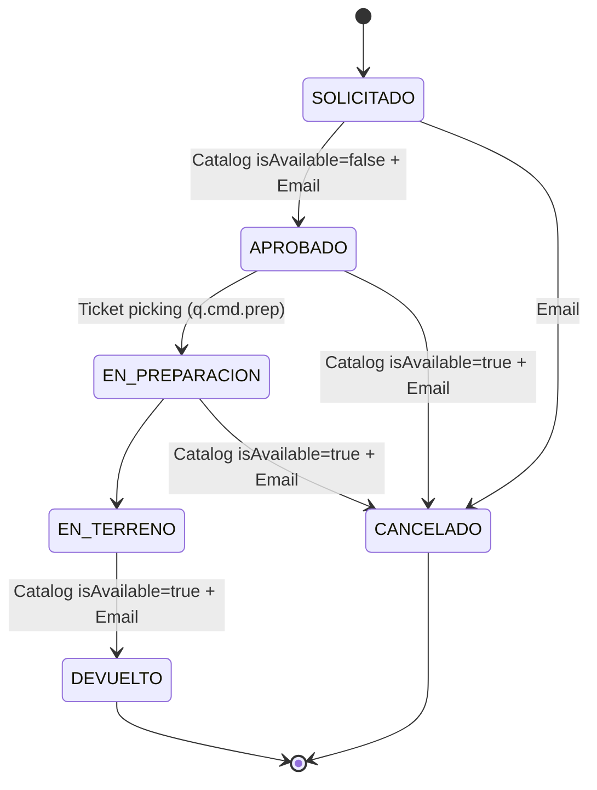

# 🚜 SmartRent — Microservicio de Arriendos (`ms-smartrent-rentals`)

Microservicio núcleo encargado del ciclo de vida de los arriendos (`Rental`), máquina de estados transaccional, protección **Anti-IDOR**, sincronización de disponibilidad con `ms-smartrent-catalog` mediante **OpenFeign**, consumo de órdenes desde RabbitMQ y emisión de eventos hacia **RabbitMQ** y **Apache Kafka (`rentals.events`)**.

---

## 🛠️ Stack Tecnológico

- **Java**: `17` | **Spring Boot**: `3.3.2`
- **Persistencia**: Spring Data JPA + PostgreSQL (`rentals`)
- **Comunicación Síncrona**: Spring Cloud OpenFeign (`CatalogClient` + `FeignTokenInterceptor`, timeouts `5s` connect / `10s` read)
- **Seguridad**: OAuth2 Resource Server JWT (Entra External ID CIAM, `@EnableMethodSecurity`, validación Anti-IDOR)
- **Mensajería**: RabbitMQ (`Jackson2JsonMessageConverter` + reintentos) y Apache Kafka (`acks=all`, `gzip`, `enable.idempotence=true`)
- **Pruebas**: JUnit 5, Mockito, JaCoCo `0.8.14`

---

## 🔄 Máquina de Estados (`RentalService`)

Transiciones válidas en [`RentalService.java`](./src/main/java/cl/duoc/mssmartrentrentals/services/RentalService.java) (ejecutadas bajo `@Transactional`):



> **Consistencia transaccional**: `catalogClient.updateAvailability(...)` se ejecuta **antes** de `rentalRepository.save(...)`. Si falla la actualización en catálogo o la transición de estado es inválida, el controlador devuelve `400 Bad Request` / `502 Bad Gateway` sin corromper el estado persistido.

---

## 📡 Endpoints REST (`/api/rentals`)

Definidos en [`RentalsController.java`](./src/main/java/cl/duoc/mssmartrentrentals/controllers/RentalsController.java):

| Método | Ruta | Autorización | Comportamiento y Seguridad |
| :---: | :--- | :--- | :--- |
| `POST` | `/api/rentals` | `ADMIN`, `JEFEBODEGA`, `ARRENDATARIO` | Crea un arriendo `SOLICITADO`. Si el rol es estrictamente `Arrendatario`, impide suplantación de `userId` usando el email del JWT. |
| `GET` | `/api/rentals` | `ADMIN`, `JEFEBODEGA`, `ARRENDATARIO` | `ADMIN`/`JEFEBODEGA` ven todos; `Arrendatario` recibe únicamente sus propios arriendos. |
| `GET` | `/api/rentals/my-rentals?userId=...` | `ADMIN`, `JEFEBODEGA`, `ARRENDATARIO` | **Anti-IDOR**: valida `userId` contra `oid`, `sub`, `email` y `preferred_username` del JWT; responde `403 Forbidden` ante discrepancia. |
| `PUT` | `/api/rentals/{id}/status` | `ADMIN`, `JEFEBODEGA` | Actualiza estado (acepta query param `status` o JSON `{ "status": "..." }`). |

---

## 📨 Integración RabbitMQ y Apache Kafka

### RabbitMQ (`RabbitMQConfig`, `OrderCreatedListener`, `RentalEventPublisher`)
- **Consumo**: escucha `q.rentals.order.created` (vinculada a `smartrent.exchange` con routing key `order.created`) para crear automáticamente arriendos `SOLICITADO` a partir de órdenes confirmadas en `ms-smartrent-checkout`.
- **Publicación**:
  - `cmd.direct` (`email.send`): notificaciones de correo al pasar a `APROBADO`, `DEVUELTO` o `CANCELADO`.
  - `q.cmd.prep` (directo): comando de impresión de ticket de alistamiento al pasar a `EN_PREPARACION`.

### Apache Kafka (`KafkaProducerConfig`, `RentalEventPublisher`)
- **Tópico**: `rentals.events` (`3` particiones, `RF=3`, `min.insync.replicas=2`, `cleanup.policy=delete`, retención `7 días` / `1 GB`).
- **DLT asociado**: `rentals.events-dlt` (retención `30 días`).
- **Clave de partición**: `String.valueOf(rentalId)` (garantiza orden secuencial por arriendo).
- **Eventos (`RentalEventDto`)**: `RENTAL_CREATED` y `RENTAL_STATUS_CHANGED` (incluyendo `previousStatus`, `status`, `machineId`, `machineName`, `userId`, `eventId`, `timestamp`).

---

## ⚙️ Variables de Entorno

| Variable / Propiedad | Valor por Defecto | Descripción |
| :--- | :--- | :--- |
| `SERVER_PORT` | `8082` | Puerto HTTP del servicio |
| `SPRING_DATASOURCE_URL` | `jdbc:postgresql://localhost:5432/smartrent_audit` | Base de datos PostgreSQL |
| `CATALOG_URL` | `http://smartrent-catalog:8081` | URL base del cliente OpenFeign de catálogo |
| `SPRING_RABBITMQ_HOST` | `localhost` | Host de RabbitMQ (`172.31.29.239` en AWS) |
| `SPRING_KAFKA_BOOTSTRAP_SERVERS` | `localhost:9092,localhost:9093,localhost:9094` | Brokers Kafka HA |

---

## 💻 Ejecución Local, Docker y Pruebas

```bash
./mvnw spring-boot:run
./mvnw test -B
docker build -t smartrent-rentals .
```
